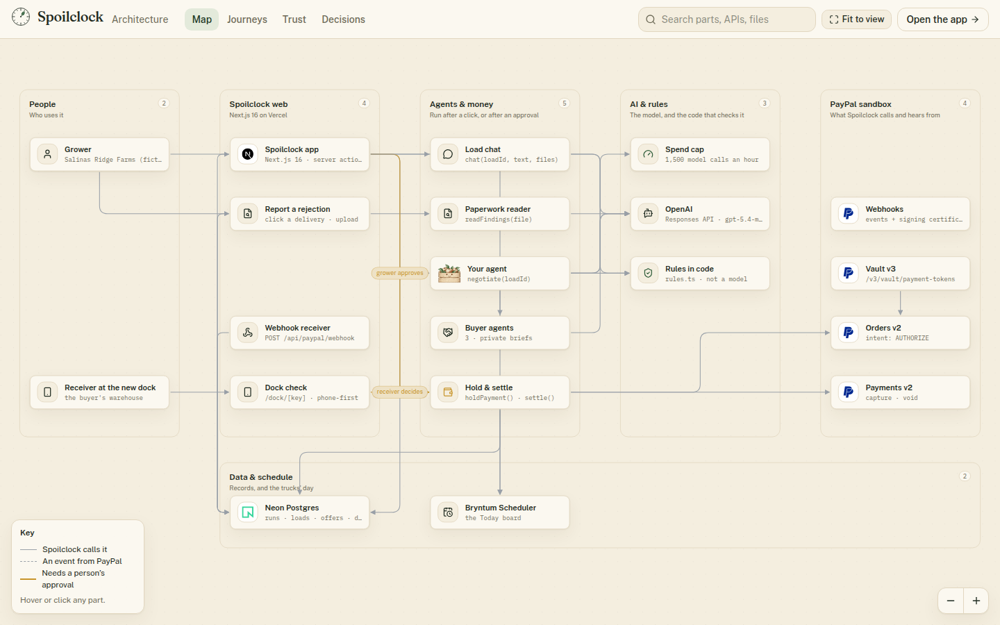

# Spoilclock

**When a produce load is rejected at the dock, an AI agent finds it a new buyer by negotiating with the buyers' own agents. PayPal holds the money until the new dock accepts the load.**

A rejected truck has hours, not days. Today a broker phones buyers one by one while the fruit warms up, and whoever answers first sets the price. In 2024, 29% of the US food supply went unsold or uneaten, worth $381 billion ([ReFED](https://refed.org/food-waste/the-problem/)), and ReFED finds that strict cosmetic standards leave imperfect-looking produce without buyers ([ReFED Insights Engine](https://refed.org/articles/key-findings-from-the-refed-insights-engine)).

Spoilclock works the phones for the grower, in about a minute:

1. **A delivery is turned away.** The grower reports it on the Today board and attaches the inspection report or a photo. The AI reads it, and a rescue clock starts from the crop's shelf life.
2. **Agents negotiate.** The grower's agent trades offers with three buyer agents at once. Each buyer agent has private limits the grower's agent can't see. Code enforces the floor, the whole load, and the clock.
3. **The grower approves.** PayPal **authorizes** the price on the buyer agent's card saved in PayPal's Vault. Nothing is charged.
4. **The new dock decides.** The receiver checks the load on a phone: **accept** (capture), **some pallets short** (partial capture, the rest released) or **reject** (void, and the agent goes back to the other buyers).

**Live:** <https://spoilclock-app.vercel.app> → **See it live**. No sign-up; each visitor gets a private copy of the farm. Video: _link added at submission_.

> Spoilclock is not affiliated with or endorsed by PayPal. It runs on the PayPal sandbox; no real money moves. Salinas Ridge Farms, its trucks and its buyers are fictional, and the buyers are simulated AI agents. Everything PayPal does is real sandbox API calls and signed webhooks.

## Try it in two minutes

1. Open the live site and click **See it live**. You're the grower at Salinas Ridge Farms. Truck 14's strawberries were just turned away at FreshMart DC.
2. Open the rescue and click **Find a buyer**. Watch the price ladder: your agent's ask comes down, the buyer agents' bids come up, round by round.
3. Try the chat: *"Don't sell to Bargain Fresh"* or *"Raise my floor to $160"*. The rule changes, and the agent negotiates by it.
4. **Approve and hold payment.** PayPal authorizes the deal; the truck's new delivery appears on the Today board.
5. **Open the dock check** (or scan the QR code with your phone) and accept, mark pallets short, or reject.
6. **Money** shows every PayPal step with its reference and its signed webhook. **Loads**, **Buyers** and **Rules** show the rest.
7. On **Today**, click any other delivery to report a rejection yourself, with your own inspection PDF or photo.

## What's real

| Part | Real or simulated |
| --- | --- |
| PayPal | Real sandbox calls: Orders v2 `AUTHORIZE`, authorization `capture` (full and partial with `final_capture`) and `void`; Vault v3 payment tokens; webhooks verified against PayPal's signature |
| Money | Sandbox money, captured into the grower's sandbox business account |
| Buyer cards | PayPal's public sandbox test cards, saved once in PayPal's Vault (`scripts/setup-buyer-cards.ts`). Spoilclock stores only the Vault token and the last four digits |
| AI | Real model calls (`gpt-5.4-mini`), each recorded with its tokens and time |
| Paperwork | Uploaded PDFs and photos are really read by the AI. The farm's own sample paperwork is generated and marked "sample" |
| The farm, trucks and buyers | Fictional. The buyers are simulated agents with private briefs (`src/lib/buyers.ts`) |

## How the AI works

**The grower's agent** (`src/server/ai/negotiate.ts`, loop in `src/server/ai/agent.ts`) opens with a forced plan, then reads the paperwork and checks which buyers can take the load (`read_file`, `list_buyers`). Each round it sees every buyer's bid trail and either names a lower ask or accepts one.

**Each buyer agent** is a separate model call with its own private brief: its top price (as a share of the original price), how many pallets it can take, the grades it accepts. It sees only the seller's ask and its own last bid.

**Code decides what stands** (`src/lib/rules.ts`, with tests in `src/lib/rules.test.ts`):
- asks never go below the floor; bids never above the buyer's own limit;
- a deal needs one buyer for the whole load, unloaded before the fruit spoils, at an open dock;
- on the last round, code takes the best allowed bid if the model doesn't.

**The chat** (`src/server/ai/chat.ts`) answers from the load's facts and files, and can change two rules when asked: the floor and the buyers allowed. If a change breaks a deal waiting for approval, the deal is withdrawn and the agent goes back to the table. Once PayPal is holding the money, the deal is locked.

**The paperwork reader** (`src/server/ai/inspect.ts`) turns an inspection report or photo into reason, grade, % soft and pulp temperature, which the grower checks before anything opens.

**Measured on the live site** (25 Oct 2026): a negotiation took 16–20 model calls and 17–26 seconds, about 9,000 tokens in and 2,600 out.

There is no eval suite for the agents yet; the rules they negotiate under are unit-tested.

## PayPal

| API | Calls | Where |
| --- | --- | --- |
| Orders v2 | `POST /v2/checkout/orders` with `intent: AUTHORIZE` and `payment_source.card.vault_id` | `src/server/paypal/money.ts` |
| Payments v2 | `POST /v2/payments/authorizations/{id}/capture` (full, or partial with `final_capture: true`) · `POST /v2/payments/authorizations/{id}/void` | `src/server/paypal/money.ts` |
| Vault v3 | `POST /v3/vault/setup-tokens` → `POST /v3/vault/payment-tokens` | `scripts/setup-buyer-cards.ts` |
| Webhooks | `PAYMENT.AUTHORIZATION.CREATED`, `PAYMENT.AUTHORIZATION.VOIDED`, `PAYMENT.CAPTURE.COMPLETED` (+ `DENIED`, `REFUNDED`), checked on the raw bytes with PayPal's certificate, falling back to `verify-webhook-signature` | `src/server/paypal/webhooks.ts`, `src/lib/paypal-signature.ts` |

- **Nothing can be held or charged twice.** Each step is claimed in the database first and sent with a fixed `PayPal-Request-Id` (`hold-<deal>`, `capture-<deal>`, `void-<deal>`).
- **Only people move money.** No agent has a PayPal tool; only the grower's Approve and the dock's tap call PayPal.
- **Refusals are explained, not hidden.** A PayPal outage or refusal reaches the screen in plain words, and the hold stays safe.

## Bryntum Scheduler

The **Today** board is Bryntum Scheduler: trucks as rows, pickups and deliveries as bars, a live "now" line. When a load is rejected its bar turns rust; when the grower approves a deal, **the agent's new delivery appears on the schedule** as a dashed bar ending when the truck will be unloaded. Click any delivery to report a rejection; click a rescue to open it.

The trial build is used, as the hackathon offers, so the board carries Bryntum's trial watermark. Bryntum's prebuilt module is served from `public/` and loaded at runtime (`scripts/copy-bryntum.mjs`) instead of being bundled, which kept the build within memory.

## Architecture

[](https://spoilclock-app.vercel.app/architecture)

**Explore it live at [spoilclock-app.vercel.app/architecture](https://spoilclock-app.vercel.app/architecture).** You can:
- click any part to see what it does, its real calls and its code;
- play a journey step by step (a load rescued, a rejection reported, the dock says no, the grower talks to the agent);
- open the Trust lens to see what the AI can't do;
- read the decisions behind each choice.

Everything on that page comes from one file, `src/lib/architecture.ts`.

| Piece | What it runs |
| --- | --- |
| Vercel (Next.js 16) | The app, server actions, the dock check, the PayPal webhook. Negotiations run after the response with `after()` |
| Neon Postgres | Each visitor's run: trips, loads, every offer, deals, chat, files, PayPal events, model calls |
| OpenAI | The grower's agent, three buyer agents, the chat, the paperwork reader |
| PayPal sandbox | Orders v2, Payments v2, Vault v3, Webhooks |
| Bryntum Scheduler | The Today board |

## Run it locally

Needs Node 22, a PayPal sandbox REST app (US business account, with Vault enabled), an OpenAI key and a Postgres database (Neon's free tier works).

```bash
git clone <this repo> && cd spoilclock
npm install
cp .env.example .env.local        # fill in DATABASE_URL, OPENAI_API_KEY, PayPal keys
npm run db:migrate
npx tsx --conditions=react-server --env-file=.env.local scripts/setup-buyer-cards.ts   # one saved card per buyer agent
npm run dev                       # http://localhost:3000
```

- Register the PayPal webhook to `<your URL>/api/paypal/webhook` with `node --env-file=.env.local scripts/register-webhook.mjs https://<your host>/api/paypal/webhook`, and put its id in `PAYPAL_WEBHOOK_ID`.
- Bryntum's trial package is installed from npm as `@bryntum/scheduler@npm:@bryntum/scheduler-trial`.

| Command | What it does |
| --- | --- |
| `npm test` | Vitest: the negotiation rules and the webhook signature check |
| `npm run lint` · `npm run typecheck` | ESLint and TypeScript |

## Built with

Next.js 16, React 19, TypeScript, Tailwind CSS 4, shadcn/ui on Base UI, Motion · OpenAI Responses API · PayPal Orders v2, Payments v2, Vault v3 and Webhooks · Bryntum Scheduler · Neon Postgres with Drizzle · Vercel · unpdf and pdf-lib · Vitest, and Playwright for screenshots and click-through tests.

Design notes are in [docs/DESIGN.md](docs/DESIGN.md); the demo script is in [docs/DEMO.md](docs/DEMO.md).

## Licence

[MIT](LICENSE)
